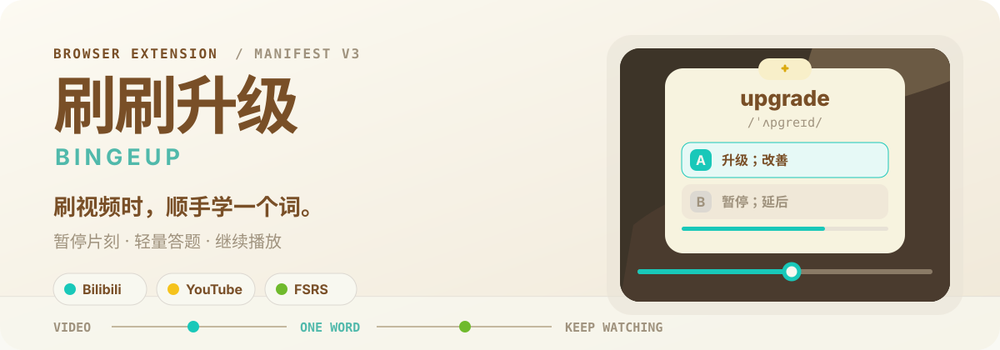
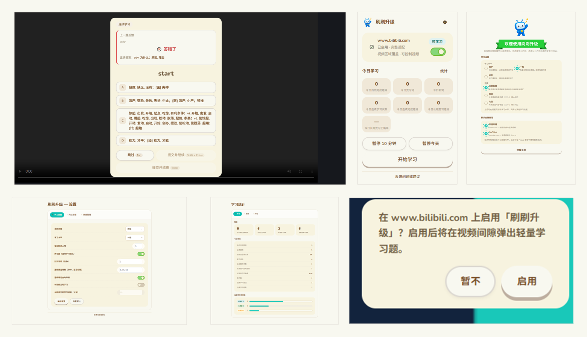
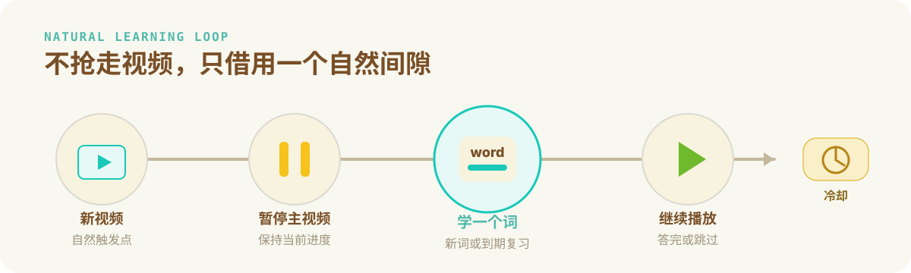

<p align="center">
  
</p>

<p align="center">
  <strong>刷着刷着，就升级了。</strong><br>
  一款把轻量英语学习放进视频自然间隙的浏览器扩展。
</p>

<p align="center">
  Chrome / Edge · Bilibili / YouTube · React + TypeScript · Apache-2.0
</p>

## 先看它怎么工作

当你进入新视频，刷刷升级会暂停主视频并盖上一道轻量学习题。答完或跳过后，视频从原进度继续；如果你想多学几题，也可以主动进入连续学习。

<p align="center">
  
</p>

<p align="center"><sub>界面合集：视频内学习与连续答题、首次引导、设置页、学习统计、插件状态控制与启用提示。所有画面来自真实构建产物截图；视频场景为合成测试页。</sub></p>

## 学习被放在间隙里，而不是待办清单里

- **自然触发**：进入新视频时出现学习界面；长视频定时学习由用户主动开启。
- **轻量完成**：新词展示、选择题和拼写题都在浮层内完成，不离开当前页面。
- **到期优先**：长期复习由 FSRS 调度；没有到期复习时再展示候选新词。
- **懂得退后**：正常完成后进入全局冷却，连续跳过会逐级延长冷却。
- **随时多学**：选择“提交并继续”即可保持视频暂停，连续处理多个学习项目。

<p align="center">
  
</p>

## 现在可以做什么

| 场景 | 能力 |
| --- | --- |
| 视频学习 | Bilibili 与 YouTube 的普通视频、竖屏视频和直播识别 |
| 学习内容 | 日常高频、四级、六级三套内置词库，可选择学习水平 |
| 题型 | 英选中、中选英、例句语境选择与拼写题 |
| 复习 | 新词短期巩固 + FSRS 长期复习调度 |
| 节奏 | 默认冷却、连续跳过降频、全局暂停、连续学习 |
| 数据 | 今日统计、导出、恢复备份、清除学习进度或全部数据 |

> [!NOTE]
> 学习进度、设置与复习记录保存在浏览器本地。内置词库随扩展提供，不会混入用户备份。

## 本地安装

> [!WARNING]
> 当前处于 **v0.0.1 测试版**，插件尚未完成，功能可能不稳定，仅供体验与反馈，不建议日常使用。

### 方式一：从 Release 下载（推荐）

1. 打开 [Releases 页面](https://github.com/F1rstDan/BingeUp/releases)，下载对应浏览器的压缩包：Chrome 用 `bingeup-0.0.1-chrome.zip`，Edge 用 `bingeup-0.0.1-edge.zip`。
2. 将压缩包**解压**到一个文件夹（Chrome / Edge 无法直接加载 `.zip`，必须先解压）。
3. 打开扩展管理页：Chrome 为 `chrome://extensions/`，Edge 为 `edge://extensions/`。
4. 开启「开发者模式」。
5. 点击「加载已解压的扩展程序」，选择刚解压出的文件夹。
6. 打开 Bilibili 或 YouTube，完成首次引导后进入一个视频。

### 方式二：从源码构建（开发 / 进阶）

```bash
git clone https://github.com/F1rstDan/BingeUp.git
cd BingeUp
npm install
npm run build
```

然后在 Chrome 或 Edge 中：

1. 打开扩展管理页：Chrome 为 `chrome://extensions/`，Edge 为 `edge://extensions/`。
2. 开启「开发者模式」。
3. 点击「加载已解压的扩展程序」。
4. 选择构建产物目录 `.output/chrome-mv3`；Edge 构建请先运行 `npm run build:edge`，再选择 `.output/edge-mv3`。
5. 打开 Bilibili 或 YouTube，完成首次引导后进入一个视频。

修改代码并重新构建后，在扩展管理页点击「重新加载」。

### 卸载

1. 在扩展管理页的「刷刷升级」卡片上点击「移除」。
2. 卸载会一并清除该扩展的本地数据（学习进度、设置、词库）。如需保留，请先导出备份。

### 数据备份

- **导出**：设置页 →「数据管理」→「导出数据」，会下载一个 `bingeup-backup-YYYY-MM-DD.json`。备份仅包含用户数据（学习进度、设置、网站配置），不含随扩展分发的内置词库。
- **导入 / 恢复**：设置页 →「数据管理」→「导入数据」，选择此前导出的 JSON 即可原子恢复；导入失败会保持原数据不变。
- **自动恢复**：扩展会在本机保留一份恢复快照；若 IndexedDB 被浏览器整体重置，下次启动会自动恢复学习进度。该快照不替代手动导出，跨设备或重装扩展前仍建议导出备份。
- **存档读取状态**：数据管理页会显示最近一次后台启动读取到的记录数、当前记录数、是否使用了自动快照、最近保存时间和最近几次启动记录，便于反馈丢档问题。
- **重置**：「清除学习进度」删除学习卡 / 复习日志 / 会话与指标源事件，使派生统计归零，但保留设置、网站配置与内置词库；「清除全部数据」删除全部本地用户数据、回到刚安装状态，随扩展提供的内置词库仍可用。

## 反馈

Beta 阶段的问题与建议，欢迎通过扩展内入口反馈：Popup 或设置页底部的「反馈问题或建议」会打开预填的 [GitHub Issues](https://github.com/F1rstDan/BingeUp/issues) 新建页面（自动带上扩展版本与浏览器信息，便于复现）。本扩展不设账号、不做任何远程行为分析或数据上报。

## 开发

前置要求：Node.js 22+。

```bash
npm install          # 安装依赖
npm run dev          # Chrome 开发模式，支持 HMR
npm run typecheck    # TypeScript 类型检查
npm test             # 运行测试
npm run lint         # ESLint 检查
npm run build        # Chrome 生产构建
```

<details>
<summary><strong>全部项目命令</strong></summary>

| 用途 | 命令 |
| --- | --- |
| Chrome 开发模式 | `npm run dev` |
| Edge 开发模式 | `npm run dev:edge` |
| 本地 UI 预览页 | `npm run dev:preview` |
| 类型检查 | `npm run typecheck` |
| 单元 / 集成测试 | `npm test` |
| 测试监听 | `npm run test:watch` |
| 浏览器 E2E（本地手动） | `npm run test:e2e` |
| Lint 检查 / 修复 | `npm run lint` / `npm run lint:fix` |
| 格式化 / 检查 | `npm run format` / `npm run format:check` |
| 推送前检查（等价 CI 门禁） | `npm run check` |
| Chrome / Edge 构建 | `npm run build` / `npm run build:edge` |
| 打包 zip | `npm run zip` |

</details>

### 本地 UI 预览（开发调试用）

在普通网页里逐块查看全部界面，用于人工验收与批注。预览站独立于扩展构建：

```bash
npm install           # 首次使用
npm run dev:preview   # 启动后打开 http://localhost:5174
```

预览页包含：Popup（可学习 / 已暂停 / 无活动标签页 / 需权限四态）、设置页（学习设置 / 网站管理 / 数据管理）、统计页（非空与空态）、安装引导，以及视频遮罩的七个状态（新词展示、选择题、拼写题、答题正确 / 错误反馈、连续学习反馈）与启用提示、播放恢复提示。遮罩与提示通过 Shadow DOM + 真实样式管线渲染，与扩展内一致；数据来自内置演示 mock，可直接点选交互。

预览站只复用一个明确的仿真缝——`preview/mock-message-client.ts` 替换 `@/messaging/message-client`，其余组件、样式与类型全部来自 `src/`；浏览器 API 由 `preview/chrome-shim.ts` 提供。页面只存在于开发环境，不会进入扩展产物（`npm run build` 仍以 `src/` 为唯一来源）。

预览站适合配合 Codex 的内置浏览器使用：打开页面后按区块圈选批注或截图说明问题，回到对话里反馈即可。

项目基于 [WXT](https://wxt.dev/)、React 18、TypeScript、IndexedDB、[ts-fsrs](https://github.com/open-spaced-repetition/ts-fsrs) 与 Manifest V3。领域术语见 [CONTEXT.md](./CONTEXT.md)，架构决策见 [docs/adr](./docs/adr)。

## License

本项目以 [Apache License 2.0](./LICENSE) 发布。第三方组件与字体（animal-island-ui、naive-icons、Nunito / Noto Sans SC）的版权与许可声明见 [THIRD-PARTY-NOTICES.md](./THIRD-PARTY-NOTICES.md)。
