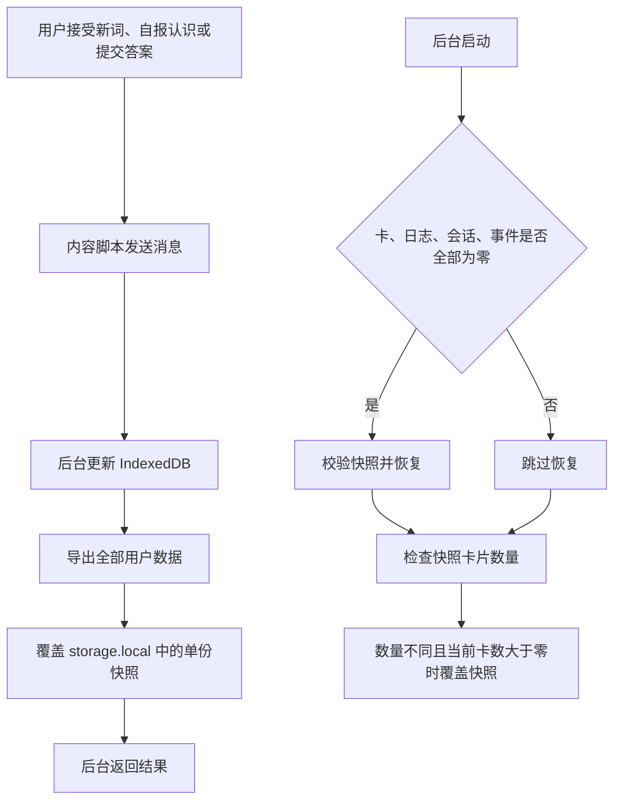

# 存档系统检查报告

检查日期：2026-10-30，Asia/Shanghai。代码基线：`104802b`。

**结论：现有存档系统有恢复和备份保护缺陷，应先修复这些缺陷。当前证据不足以支持更换 IndexedDB。**

本次已复现“已认识的词重新成为新词”的路径。前提是学习卡已经丢失，而行为事件仍在。系统没有恢复快照，随后把原来的词当成候选新词。部分丢失时，系统还会覆盖较完整的旧快照。

本次没有查明用户日常 Edge 中第一次丢卡的原因。普通重启测试没有发生丢卡。不能把故障注入的删卡动作解释成浏览器自动删卡，也不能把历史问题重新归因于数据库改名。

## 检查范围与证据边界

本次读取了关联聊天“修复关闭浏览器后存档丢失”。用户已明确说明：问题发生在日常 Edge 加载的解压缩扩展中，而且早于数据库改名。

本次检查覆盖数据库初始化、学习卡创建、选词、答题事务、消息确认、设置、快照、恢复、导入、清除、诊断、扩展身份和测试覆盖。

本次仅新增报告和隔离复现脚本，没有修改 `src/` 下的产品代码。浏览器测试使用新建的专用配置目录，没有读取或修改日常 Edge 的配置目录。历史备份只读入隔离测试数据库，没有覆盖用户存档。

证据分为三类：

- **实测缺陷**：独立测试或真实浏览器测试已触发。
- **代码确认的风险**：已追踪调用链，但没有复现用户当时的环境。
- **未确认原因**：目前没有历史现场证据。

## 实测结果

| 项目 | 条件 | 结果 |
| --- | --- | --- |
| 现有默认测试集 | 当前基线，61 个文件 | 994 项通过 |
| 第一轮重点测试 | 存储、后台入口、学习服务，11 个文件 | 194 项通过 |
| 独立故障测试 | 真实存储与学习服务代码，模拟 IndexedDB 和扩展存储 | 3 项对照通过；5 项保护断言失败 |
| Chromium 重启 | 149.0.7827.55，生产扩展，同一独立配置目录 | 连续 10 次正常关闭重开，卡片全部保留 |
| Edge 重启 | 156.0.4314.50，生产扩展，同一独立配置目录 | 连续 5 次正常关闭重开，卡片全部保留 |
| 浏览器内部分丢失 | 两种浏览器中，只删测试学习卡，保留行为事件 | 卡 0、事件 2、快照卡 1；没有恢复；原词可再次作为新词 |
| 历史备份恢复 | 旧备份、较新备份、已有合并备份 | 3 份均通过当前导入流程 |
| 工程检查 | `npm run check` | 格式、Lint、类型、994 项测试及词库检查全部通过 |
| 生产构建 | `npm run build` | 通过，包括产物和词库检查 |

真实浏览器测试调用生产消息接口，等待后台返回后才关闭浏览器。测试没有模拟用户点击后立即强制结束浏览器、系统崩溃、断电或磁盘损坏。选词含随机抽样；部分丢失测试排除了其他词，以确定性验证原词重新进入候选集。

浏览器原始结果见 [Chromium 记录](D:/AI-Projects/_code/BingeUp/docs/reports/storage-audit-2026-10-30/evidence/chromium-result.json) 和 [Edge 记录](D:/AI-Projects/_code/BingeUp/docs/reports/storage-audit-2026-10-30/evidence/msedge-result.json)。故障断言见 [故障测试结果](D:/AI-Projects/_code/BingeUp/docs/reports/storage-audit-2026-10-30/evidence/fault-tests.json)。

## 历史备份说明了什么

本次重新读取了前次聊天引用的本地备份。以下日期使用备份内容中的 `exportedAt`，转换为北京时间；文件名可能使用 UTC 日期。

| 文件 | 实际导出时间 | 学习卡 | 复习日志 | 自报认识卡 |
| --- | --- | ---: | ---: | ---: |
| `bingeup-backup-2026-10-25-release-v1.json` | 2026-10-25 19:45:03 +08:00 | 46 | 40 | 11 |
| `bingeup-backup-2026-10-28.json` | 2026-10-29 04:02:46 +08:00 | 18 | 11 | 11 |
| `bingeup-merged-2026-10-29.json` | 前次生成的合并文件 | 52 | 46 | 17 |

旧备份中的 34 个单词，在较新备份中没有学习卡。两份备份仅有 12 个单词重合。因此，“重复新词只是正常验证题”不能解释这两份备份之间的全部差异。

备份差异证明数据集合发生过回退或替换。单凭备份不能区分外部清理、扩展身份变化、程序丢失、主动清除或导入旧数据。现有合并文件也不是缺失期间所有学习记录的完整副本。本次没有执行恢复。

三份文件均通过了当前 `importLocalData` 的校验与导入。结果见 [备份兼容性测试](D:/AI-Projects/_code/BingeUp/docs/reports/storage-audit-2026-10-30/evidence/backup-tests.json)。这只能确认这三份文件可用，不能证明任意旧格式都兼容。

## 目前的存档结构



IndexedDB 是学习进度和长期设置的权威数据源。`chrome.storage.local` 保存临时状态、诊断记录和一份恢复快照。随扩展交付的词库独立于用户存档。

浏览器正常关闭不会按设计清空 IndexedDB。后台 Service Worker 可以休眠和重新启动，不能依赖内存变量保存长期状态。当前学习卡已经写入数据库，不是仅存在内存中。[Chrome 后台生命周期文档](https://developer.chrome.com/docs/extensions/develop/concepts/service-workers/lifecycle)

## 已复现的五项保护缺陷

### F1：只恢复“四类数据全部为空”，漏掉部分丢失

**优先级：高。会产生用户描述的同类症状。**

`restoreRecoverySnapshotIfNeeded` 只要发现任意学习卡、复习日志、会话或行为事件，就跳过恢复。网站基线本身就会产生行为事件。因此，即使所有学习卡都没了，只要事件还在，系统也不会恢复。

隔离测试先调用真实 `selfReportKnown` 创建卡并保存快照，然后删除 `cards`，保留事件。连接重开后，真实 `LearningService.getNextItem` 再次返回该词的新词展示。

Chromium 和 Edge 的生产构建测试也确认：学习卡 0 张、行为事件 2 条、快照卡 1 张，系统没有恢复。限制其他候选后，原词再次作为新词出现。

代码位置：[recovery-snapshot.ts:205](D:/AI-Projects/_code/BingeUp/src/storage/recovery-snapshot.ts:205)。

不宜直接改成“卡少就自动覆盖当前数据库”。用户可能刚执行过合法导入或清除。系统应先识别异常、保留两边数据，再依据明确的版本或清除记录决定恢复方式。

### F2：启动检查会把残缺数据写成新快照

**优先级：高。会损害恢复机会。**

`saveStartupRecoverySnapshot` 把“卡片数量不同”作为重写快照的条件，没有区分数据增加和异常减少。

实测步骤：保存 2 张卡的快照 → 删除其中 1 张卡 → 重开连接 → 执行启动恢复与快照检查。结果是恢复被跳过，快照从 2 张变成 1 张。唯一的快照不再含有丢失的卡。

代码位置：[recovery-snapshot.ts:240](D:/AI-Projects/_code/BingeUp/src/storage/recovery-snapshot.ts:240)。

这解释了为什么后续检查可能找不到丢失前的数据：系统可能已经用残缺状态更新了快照。该路径已复现；用户历史上是否走过这条路径仍未确认。

### F3：卡片数量相同，不代表快照已同步

**优先级：中。会让恢复结果退回旧进度。**

启动检查只比较卡片数量。答题、调整复习时间、修改设置等操作通常不改变卡片数量。

实测先更新卡片，再让快照的完整写入和精简写入都失败。重开连接后，启动检查没有补写。数据库的 `updatedAt` 已为 `20000`，快照仍为 `10000`。

这不是当场删除数据库中的卡，而是快照长期落后。如果后来需要恢复，系统会恢复旧进度。设置和日志也不能靠卡数判断是否备份完成。

代码位置：[recovery-snapshot.ts:245](D:/AI-Projects/_code/BingeUp/src/storage/recovery-snapshot.ts:245)。

### F4：没有学习卡的设置快照不能自动恢复

**优先级：中。影响设置、网站状态和安装引导状态。**

恢复函数要求快照中至少有 1 张学习卡。只改过设置、尚未创建学习卡的用户，即使拥有完整快照，也不能用它自动恢复。

实测把每日新词上限设为 8，保存快照并清空测试数据库。恢复后上限为默认值 5。

代码位置：[recovery-snapshot.ts:209](D:/AI-Projects/_code/BingeUp/src/storage/recovery-snapshot.ts:209)。

### F5：恢复失败后继续保存，可能覆盖原快照

**优先级：高。故障时应保留的恢复来源会被覆盖。**

自动恢复复用严格的备份导入校验。恢复需要当前词库和词库成员关系都通过校验。如果词库加载失败或引用不兼容，恢复会返回错误。

启动流程会记录错误，但仍允许后续消息继续执行。常规快照写入没有“恢复尚未完成”的保护状态。

实测先保存 1 张卡，清空数据库，再模拟词库校验失败。启动补快照暂时保留原文件；随后执行常规快照保存，原来的 1 张卡变为 0 张。

代码位置：[background.ts:90](D:/AI-Projects/_code/BingeUp/src/entrypoints/background.ts:90)、[recovery-snapshot.ts:218](D:/AI-Projects/_code/BingeUp/src/storage/recovery-snapshot.ts:218)。

这个用例故意注入了校验失败。本次没有发现上述三份历史备份存在这类错误。

## 其他已确认风险

### 保存失败时，用户可能只看到题卡关闭

内容控制器会等待后台保存结果。并非所有点击都先关卡、再异步保存。正常返回下一张词卡，说明上一条消息已经收到后台响应。

但是，保存抛错后，`recoverFromFailure` 会关闭题卡并恢复视频。普通存储错误只写控制台；当前可见故障提示主要针对内容不可用和视频恢复失败。用户没有稳定的“本次未保存”提示和重试入口。

现有集成测试已经断言“保存失败后关闭题卡并返回视频”。这会造成“我点过了，过后又出现”的体验，即使数据库从未丢失已经成功提交的记录。

代码位置：[content-controller.ts:694](D:/AI-Projects/_code/BingeUp/src/content/content-controller.ts:694)。

点击后立即结束浏览器，则可能发生在消息到达或事务提交前。本次正常重启测试等待保存确认，未验证这个窗口；它也不足以单独解释几天前已成功保存的卡消失。

### 快照只有一份，而且每次重写全部数据

快照没有历史代次、持久化修订号或异常覆盖隔离。多次正常保存会反复替换唯一的恢复来源。

每次需要备份的消息都会读出全部用户数据，再序列化写入。开销随卡片和日志总量增加。当前有队列合并，可减少突发写入；本次没有测量长期大数据下的延迟，不能给出性能阈值。

IndexedDB 与 `storage.local` 不能共享一个原子事务。当前代码先提交数据库，再更新快照。快照失败后，产品通常仍返回业务结果成功。这需要用独立的“数据库已保存”和“备份未完成”状态表达。

此外，快照触发依靠手写消息白名单。暂停、恢复等消息可以新增行为事件，但不在该白名单中；这些事件可能要等后续学习或设置保存才进入快照。应让存储提交统一标记备份待更新，减少漏加消息的风险。

代码位置：[background.ts:24](D:/AI-Projects/_code/BingeUp/src/entrypoints/background.ts:24)、[data-transfer.ts:69](D:/AI-Projects/_code/BingeUp/src/storage/data-transfer.ts:69)。

### 配额不足时会丢弃快照中的明细

快照写入失败后，系统重试精简快照。精简快照保留卡片、设置和用户内容，但清空复习日志、会话和行为事件。这保住核心卡片，却不能恢复完整统计和复习历史。

当前 manifest 只有 `storage` 和 `scripting`，没有 `unlimitedStorage`，代码也没有显式请求存储持久化。Chrome 文档说明，扩展的网页存储默认受配额限制，在资源压力下存在低概率回收；`unlimitedStorage` 或获准的持久化可增加保护。`storage.local` 默认配额为 10 MB。[扩展存储说明](https://developer.chrome.com/docs/extensions/develop/concepts/storage-and-cookies)、[Storage API](https://developer.chrome.com/docs/extensions/reference/api/storage)

本次没有证明日常 Edge 发生过回收，也没有测量该配置目录是否已获得持久化授权。不能把缺少权限直接认定为历史根因。文档还明确指出，普通清除浏览数据不会清除扩展的 IndexedDB；不能照搬普通网页缓存的解释。[扩展存储说明](https://developer.chrome.com/docs/extensions/develop/concepts/storage-and-cookies)

### 当前诊断面板不能完整证明“已保存”或“没有丢卡”

- “最近保存”读取的是快照时间，不是 IndexedDB 最近一次提交时间。
- “数据减少”比较卡、日志、会话、事件的总数。卡少了但事件增加时，总数可能不减少。
- 启动后的残缺状态会成为新的比较基线。面板不会自动逐词比较上一次健康状态。
- 最近 10 条是后台启动记录。Service Worker 多次唤醒可消耗记录，不能当作 10 次浏览器启动。
- 最近自报记录每个后台启动记录只留最后一次，不能作为完整写卡凭据。
- 恢复后才记录启动条数，没有独立保留本次恢复前的全部计数。

代码位置：[OptionsApp.tsx:706](D:/AI-Projects/_code/BingeUp/src/ui/options/OptionsApp.tsx:706)、[storage-diagnostics.ts:82](D:/AI-Projects/_code/BingeUp/src/storage/storage-diagnostics.ts:82)。

### 发布身份与迁移需要约束

当前扩展版本固定为 `0.0.1`，manifest 没有固定公钥。不同构建难以仅凭版本追踪；解压缩扩展的身份也应保持稳定。Chrome 提供 manifest `key` 来维持一致扩展 ID。[Manifest key 文档](https://developer.chrome.com/docs/extensions/reference/manifest/key)

不能直接给已使用的扩展换一个新 `key`。新 ID 会使用另一个存储空间。应先核实已有 ID，再制定发布和迁移方法。当前两种浏览器的隔离测试使用同一扩展路径，ID 始终相同；没有复现身份变化。

目前数据库版本和导出版本均为 1。数据库升级代码只有首次建表，没有按 `oldVersion` 执行后续迁移的分支。备份对版本、字段和词库引用执行严格校验。未来变更结构时，需要明确迁移规则与旧备份样本测试。现有代码的打开失败不会自动删库，这一点应保留。

## 已检查且工作正常的部分

| 部分 | 当前判断与边界 |
| --- | --- |
| 自报认识 | 会创建持久化学习卡，不是只在内存中排除该词 |
| 新词选择 | 会排除数据库中所有已有卡的单词；有卡时没有发现重启后绕过排除的问题 |
| 验证题 | 自报认识后约 1–2 天出现验证题，属于现有产品规则；不同于重新展示新词 |
| 卡片唯一性 | `byWordId` 唯一索引防止同词创建多张卡 |
| 答题保存 | 卡和复习日志在同一事务提交，失败会回滚 |
| 导入 | 先校验，再在单个事务中替换；失败保留原数据 |
| 清除 | 进度清除和全部清除的主数据库写入使用事务；快照清除另有标记，跨存储中断窗口仍需专项验证 |
| 数据库打开 | 失败会报错，可重试；没有发现打开失败后自动重建的路径 |
| 整库恢复 | 所有学习记录为空且快照兼容时，可恢复；不能据此推断部分丢失也可恢复 |
| 并发保护 | 创建卡有唯一约束，同一后台实例有提交去重和快照队列；跨后台重启的幂等性仍不具备持久化凭据 |

## 是否更换存储方案

**宜保留 IndexedDB，改造保存确认、备份与故障恢复。**

目前的问题发生在“何时认为数据健康、何时覆盖快照、失败后怎样继续”这些应用规则中。把同样的规则搬到另一种数据库，仍会覆盖恢复来源。IndexedDB 已提供本项目需要的索引、唯一约束和多仓库事务。

| 方案 | 收益 | 代价与限制 | 选择 |
| --- | --- | --- | --- |
| IndexedDB + 修订号 + 多代本地快照 | 保留事务；能识别备份落后并保留恢复来源 | 要实现健康检查、备份重试和恢复状态 | 优先采用 |
| 全部改用 `chrome.storage.local` | 扩展 API 简单 | 跨记录一致性要自行实现；整包覆盖和单份快照问题仍在 | 不作为此次修复方向 |
| 改为 SQLite/WASM 或原生文件 | 可提供另一套数据库或文件能力 | 运行和发布链路更复杂；仍需处理浏览器存储或原生程序接入 | 当前没有足够收益 |
| 增加外部备份或云端副本 | 可应对整个扩展数据空间或设备丢失 | 增加授权、隐私、冲突与运维工作 | 先补本地机制，再按产品需求决定 |

同一浏览器配置目录中的两份副本，只能防御部分故障。扩展卸载、整个配置目录丢失或设备故障时，仍需配置目录之外的备份。用户导出的 JSON 已提供手动备份基础；它不等于自动外部备份。

## 最小完整改造方案

### 第一阶段：先保护恢复来源

1. 检测卡片异常减少、缺卡但存在日志，以及恢复失败等状态。
2. 进入异常状态时，保留当前数据库与已有快照，暂停自动覆盖健康快照。
3. 保存至少一个经校验的上一代快照。合法清除和导入应带明确的代次记录，避免旧数据复活。
4. 把普通保存错误显示给用户，并提供重试。已提交主数据库但备份失败时，应明确区分两种状态。
5. 让 F1、F2、F5 从失败变为通过。部分丢失的安全行为可以是进入恢复流程，不必直接用旧快照覆盖当前数据。

### 第二阶段：让备份状态可验证

1. 在每次权威数据事务中同时递增 `revision`，并记录备份待更新状态。
2. 快照保存 `revision`，按修订号判断同步状态，替代卡片数量判断。
3. 后台重启后，重试未完成的备份；成功后才能清除待更新状态。
4. 导出应在一个跨仓库只读事务中取得一致数据。当前分散读取未在本次复现出撕裂，但不宜把一致性依赖于调用时序。
5. 对无卡但有设置的快照定义恢复规则，使 F3、F4 通过。
6. 诊断分别显示最近数据库提交、最近备份成功、两边修订号、逐类计数、恢复前后计数和错误原因。

### 第三阶段：补发布与灾难恢复验证

1. 评估 `unlimitedStorage` 或显式持久化，记录实际授权和空间使用情况。
2. 稳定扩展身份，递增发布版本，恢复数据库和备份的版本迁移测试。
3. 定期校验快照可导入性；把外部导出入口与恢复说明做清楚。
4. 把真实浏览器的同配置重启测试纳入发布检查。
5. 补充保存中断、后台终止、部分丢失、配额不足、清除与导入中断的专项测试。

此次修复不宜引入完整事件溯源、替换学习调度器或重写全部数据层。持久化修订号、受保护的多代快照和明确的恢复状态，已足以覆盖本次发现的主要缺口。

## 后续怎样确认历史根因

下一次异常时，需要区分三种证据：

| 现场 | 倾向说明 | 不能直接推出 |
| --- | --- | --- |
| 已确认写入的卡随后消失，扩展 ID 与配置目录不变 | 数据被删除、替换或回退，应检查最近清除、导入、数据库创建记录和存储错误 | 浏览器必然自动清理 |
| 数据库有该词学习卡，但仍返回同词新词展示 | 选词或身份映射问题，应比对实际 `wordId` | 整个数据库丢失 |
| 没有成功保存凭据，点击后出现通信或存储错误 | 当次操作可能未保存 | 几天前的全部进度都丢了 |

系统应保存最近一次健康修订号和数据库创建标识，并为写卡、导入、清除记录持久化结果。保存失败应在当次交互中提示，避免等到重启后才被发现。当前仅靠卡片总数和快照时间，无法闭合历史因果链。

## 复现方式与交付物

在仓库根目录运行：

```powershell
npx vitest run --config docs/reports/storage-audit-2026-10-30/vitest.config.ts
```

基线上的预期结果是 **5 项失败、3 项通过，退出码 1**。失败表示保护要求没有满足，不表示测试工具运行失败。该测试不进入默认 `npm test`，便于后续修复逐项验证。

生产构建后的真实浏览器检查：

```powershell
npm run build
node docs/reports/storage-audit-2026-10-30/browser-restart.mjs chromium 10
node docs/reports/storage-audit-2026-10-30/browser-restart.mjs msedge 5
```

浏览器脚本每次创建新测试配置，只删除自己创建的测试学习卡。脚本最后确认当前缺陷确实可触发，因此当前版本脚本退出码为 0；这不表示缺陷已修复。修复后应把该断言改为安全行为检查。

可通过 `BINGEUP_AUDIT_BACKUPS` 环境变量提供以分号分隔的备份路径，并使用 `-t 'BACKUP:'` 单独执行备份校验。本次没有修改原始备份。

交付包括本报告、独立测试配置、故障用例、真实浏览器脚本和结果 JSON。产品代码尚未实施上述改造；本报告没有宣称历史根因已经确认。
