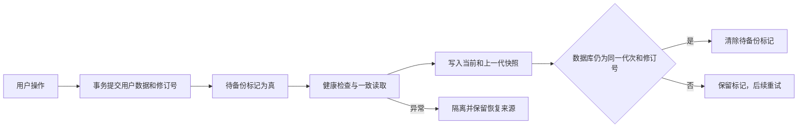

# 存档保护改造记录

按 2026-10-30 存档检查报告的顺序实施。每项完成后独立提交。历史报告与故障证据保留原样。

用户纠正后，插件版本回到 `0.0.1`，数据库结构和自动快照格式版本回到 `1`。保留存档保护功能，删除数据库升级和多版本快照兼容分支。插件仍在内测，尚未上线；今后仅在用户明确要求升级版本号时修改版本号。

| 顺序 | 优化点 | 状态 | 提交 |
| --- | --- | --- | --- |
| 1.1 | 检测卡片减少、孤立日志与恢复失败 | 已完成 | `c955745`；一致性修正 `910b880` |
| 1.2 | 隔离异常存档，保护数据库与健康快照 | 已完成 | `545f659` |
| 1.3 | 保留上一代快照，区分合法替换和清除 | 已完成 | `dbff928` |
| 1.4 | 显示保存错误，提供重试并区分备份失败 | 已完成 | `807bde9`、`d1dc245` |
| 1.5 | 验证 F1、F2、F5 的安全行为 | 已完成 | `71d818f` |
| S1 | 失败关闭隔离与跨存储操作标记 | 已完成 | `63c3db5`、`48c771c`、`fb18e4b` |
| S2 | 校验保存响应，备份重试成功关闭提示 | 已完成 | `b2966d3` |
| 2.1 | 权威事务原子记录修订号与待备份状态 | 已完成 | `82c8348`；并发测试 `fcc6286` |
| 2.2 | 快照按修订号判断同步 | 已完成 | `c411ff7` |
| 2.3 | 后台重启后重试待备份数据 | 已完成 | `6934b52` |
| 2.4 | 在一致的只读事务中导出数据 | 已完成 | `9aed5e4` |
| 2.5 | 恢复无卡设置快照，验证 F3、F4 | 已完成 | `ba32371` |
| 2.6 | 展示提交、备份、修订号与逐类诊断 | 已完成 | `6564492` |
| 3.1 | 增加持久化保护与空间诊断 | 已完成 | `88cee7d` |
| 3.2 | 保持扩展身份 | 保留身份保护；版本升级与兼容迁移已撤回 | 原提交 `bd93f22` |
| 3.3 | 校验快照可恢复性，补外部备份说明 | 已完成 | `825b1cf` |
| 3.4 | 将同配置重启测试纳入发布检查 | 已完成 | `f727e32` |
| 3.5 | 验证中断、配额、部分丢失与替换失败 | 已完成 | `b822959` |

数据库名和已有扩展 ID 保持不变。生产浏览器测试使用独立配置目录。Git 提交由指定子智能体编写简化技术中文信息。

模型：`opencode-go/deepseek-v4.1-flash`。思考程度：`max`。

## 保存确认流程

修复后的原审计回归共 8 项，已全部通过。历史失败结果保留，新结果另存为 `fault-tests-storage-hardening-final.json`。

## 当前方案与边界

继续使用 IndexedDB 保存权威用户数据；同一事务保存修订号和待备份状态。扩展本地存储保存经校验的当前快照和上一代快照。配额不足时可以精简新快照的日志，但不能删除已有上一代来伪称备份成功。

采用 `unlimitedStorage`，并读取实际授权、持久化状态和空间估算。Chrome 官方说明该权限同时作用于扩展存储和 Web 存储，并免除相应配额和回收限制：[Storage and cookies](https://developer.chrome.com/docs/extensions/develop/concepts/storage-and-cookies)。这不提供设备故障、卸载或整个浏览器配置丢失后的恢复保证。

只有全部权威仓库为空时才自动恢复。部分丢失时进入隔离，保留当前数据与快照，允许分别导出后由用户明确恢复。元数据异常和未确认的破坏性操作不能被当成正常新存档。

数据库名仍为 `bingeup`，数据库结构、公共 JSON 备份和自动快照格式的版本均为 `1`，插件版本为 `0.0.1`。内测更新沿用原加载目录和扩展 ID，不能通过卸载重装更新。`revision` 是数据提交序号，不是数据库结构或软件版本。

历史丢档最初由什么操作或浏览器状态触发，仍没有充分现场证据。本轮确认并修复的是可复现的应用保护缺口，没有把“浏览器重启”认定为历史根因。

操作说明见 [存档备份与恢复](storage-recovery.md)，构建验证见 [内测构建与存档检查](storage-release-check.md)。

## 故障验证与安全结果

| 场景 | 结果 |
| --- | --- |
| 卡片丢失但行为事件尚在 | 隔离；保留数据库现场和健康快照 |
| 部分卡片减少 | 不用缺失数据覆盖原快照 |
| 卡片数量相同但内容更新，快照写入失败 | 重启按修订号补写 |
| 只有设置的快照遇到整库丢失 | 恢复设置；已有新设置时不回退 |
| 恢复因词库引用校验失败 | 保留快照并隔离 |
| 备份期间发生新写入 | 旧确认不清除新修订的待备份标记 |
| 当前或上一代快照损坏 | 停止轮换；有效的另一份仍可单独导出 |
| 完整和精简备份均因配额失败 | 保留原档案与待备份标记，不删除上一代 |
| Chromium 与 Edge 各 5 轮同配置重启 | 学习卡、扩展 ID、数据库和备份修订保持一致 |
| 生产构建备份写入失败后关闭整个浏览器 | 主数据库保持设置；重启后补写并确认最新修订 |
| 卡片总数增长但旧卡缺失 | 仍识别缺失的旧卡并保护健康快照 |
| 同代次数据库修订低于快照 | 识别回退并隔离，不覆盖较新的快照 |
| 数据库元数据缺失、非法或修订溢出 | 拒绝写入与备份确认；数据事务回滚；保留快照 |
| 破坏性操作在数据库写入前或后中断 | 重载后结果仍视为未知；保留标记与隔离，要求明确重做 |
| 清除后在途答题或更正继续保存 | 最终事务检查学习卡仍存在，拒绝旧卡复活 |

浏览器测试仅使用脚本新建的配置目录。故障注入结果用于验证保护行为，不证明真实浏览器曾主动删除历史存档。

## 最终验证

- 本轮回退后 `npm run check`：64 个测试文件、1110 项测试通过；格式、Lint、Typecheck 和词库校验通过。
- 原审计独立回归：8 项通过。
- 本轮 `npm run build`、`npm run build:edge`：通过，两份 manifest 的插件版本均为 `0.0.1`。
- `npm run test:storage:restart`：Chromium 149、Edge 156 各 5 轮重启与部分丢失保护通过。
- `npm run test:storage:interruption`：两个浏览器的备份失败与重启补写通过。
- 已检查生产诊断截图；没有操作日常浏览器配置，没有推送或发布远程版本。
- 用户提供的实际 JSON 备份已在隔离数据库中通过导入校验；原文件未修改，安全副本保存在忽略提交的 `.output/` 目录，备份内容不进入 Git。
- 首次综合目标运行曾有一项答题身份冲突回归失败。原因是测试随机选词后仍硬编码 `w-benefit`，该值可能等于实际 `question.wordId`。测试输入已改为 `${question.wordId}-mismatch`，确保持久化身份检查收到不同值；修正见“最后测试修正提交”。

后台中断专项采用关闭整个测试浏览器来终止后台，再以同配置重启。破坏性操作精确中断点通过可控测试屏障和模块重载验证；本次没有把真实浏览器随机终止恰好落在该窗口描述为已实测。

实际存档重建未执行：浏览器工具安全策略拒绝访问扩展管理页，并禁止通过其他浏览器控制方式绕过。用户需先保留已验证备份，在更新后的扩展设置页明确重建本地数据，再导入备份。本轮没有自动删库或修改日常配置中的学习记录。
